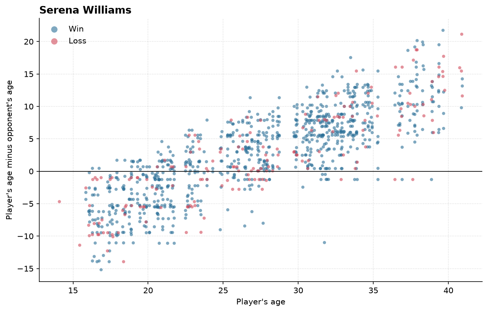

# tennisage

A Python package that downloads a tennis player's career matches from
[Tennis Abstract](https://www.tennisabstract.com) and plots the player's age
against the age gap with each opponent, in the style of the New York Times
graphic on Serena Williams's opponents.

## Installation

```bash
pip install git+https://github.com/UCB-stat159-f26/hw03-preishagarwal.git
```

## Usage

```python
from tennisage import get_player_matches, plot_age_gap

# Serena Williams data and plot
serena = get_player_matches("serena williams")
plot_age_gap(serena, title="Serena Williams")

# Rafael Nadal data and plot
rafa = get_player_matches("Rafael Nadal")
fig = plot_age_gap(rafa, title="Rafael Nadal")
fig.savefig("nadal.png")

# An unknown player raises a clear error
get_player_matches("GastonSanchez")
# ValueError: Could not find career matches for 'GastonSanchez' on
# tennisabstract.com (looked for GastonSanchez). Check the spelling, ...
```

Names work in any of these forms: `"serena williams"`, `"Serena Williams"`,
`"SerenaWilliams"`.



## Functions

### `get_player_matches(name)`

Downloads the player's `Career.js` file and birthdate from Tennis Abstract and
returns a data frame with one row per match:

| Column | Meaning |
|---|---|
| `date` | Tournament start date |
| `result` | `W` or `L`, from the player's point of view |
| `round` | Round of the match (e.g., `R32`, `QF`, `F`) |
| `opp_name` | Opponent's name |
| `opp_age` | Opponent's age at the match (years) |
| `player_age` | Player's age at the match (years) |
| `age_diff` | `player_age - opp_age` (positive means a younger opponent) |

Rows are sorted by date and round. Matches where the opponent's age is unknown
are dropped.

### `plot_age_gap(matches, title=...)`

Takes the data frame from `get_player_matches()` and returns a 
figure with the player's age on the x-axis, age difference on the y-axis, colored by
win or loss. Points above the zero line are matches against younger opponents.

## Data notes

- **Women's vs. men's files.** Women's career files store each opponent's
  birthdate, so the package computes the opponent's age. Men's files store the
  opponent's age directly.
- **Ages are approximate.** Tennis Abstract records the tournament start date,
  so ages can be off by up to about two weeks.
- **Coverage.** The package reads each player's `Career.js` file, as the
  assignment specifies. For some players, Tennis Abstract keeps newer matches in
  a separate file, so their plots may end before their careers did. For
  example, Rafael Nadal's career file ends in October 2016.

## Running the tests

```bash
git clone https://github.com/UCB-stat159-f26/hw03-preishagarwal.git
cd hw03-preishagarwal
pip install -e . pytest
pytest
```

## Reflections

*Turning scripts into a package.** In HW2 my code was three scripts that
only worked for Serena Williams, with her name and birthdate hardcoded. For
this assignment I had to rethink each step as a function that takes a player's
name as input. I also learned the parts of a Python package, including: 
- `pyproject.toml` tells pip what to install - the `src/` layout keeps the
package separate from the tests
- `__init__.py` decides which functions
users can import.

**Environment problems.** I had some test runs fail due to packages not 
being installed properly or because I opened a new terminal that switched 
off my virtual environmet. Because of this, I added `pythonpath = ["src"]` to the
pytest settings so the tests find the package either way. I also initially forgot 
my `.gitignore` so Python cache files got committed,
and I learned how to remove them with `git rm --cached`.

**Testing without the live site.** Following the rule to never hit
tennisabstract.com in tests changed how I split up the code. I kept all
downloading in one module (`_fetch.py`) and wrote the parsing and cleaning
functions to take text as input, so tests can pass in the mock JS content.
For the end-to-end tests I used pytest's `monkeypatch` to replace the
download function with a fake one that returns mock data. That also let me
test the error message for an unknown player without making a real request.

**Men's vs. women's files.** Women's files store each opponent's birthdate,
while men's files store the opponent's age. My first idea was to tell them
apart by row length, since the mock men's rows were longer. Then I noticed in
my HW2 code that women's rows with serve stats have 44 fields, which would
have been labeled as men's. I switched to checking whether field 16 contains
a decimal point, and added a test with a 44-field women's row so the bug
can't come back.

**Finding the player's birthdate.** The career files have opponents' ages but
not the player's own birthdate. Searching the player page in Safari found
nothing because the date is filled in by JavaScript.

**A gap in the data.** When I tested the package on Rafael Nadal, his ages
stopped at 30, even though he played until 38. I found that Tennis Abstract
keeps newer matches in a separate file, but for Nadal that file only covers
2017 and 2018, and it mixes the age and birthdate formats within the same
file. Merging it would have added a lot of complexity and still left his
career incomplete. I decided to stay with the career files the assignment
specifies and document the limitation in this README.

**Function length limits.** The 20-line and 10-line limits pushed me to break
the work into small helpers that each do one thing, like formatting a name,
building a URL, or adding one column. Small functions turned out to be much
easier to test one at a time. 
